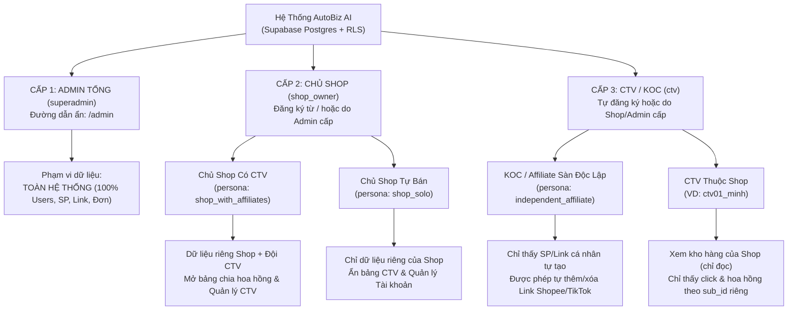
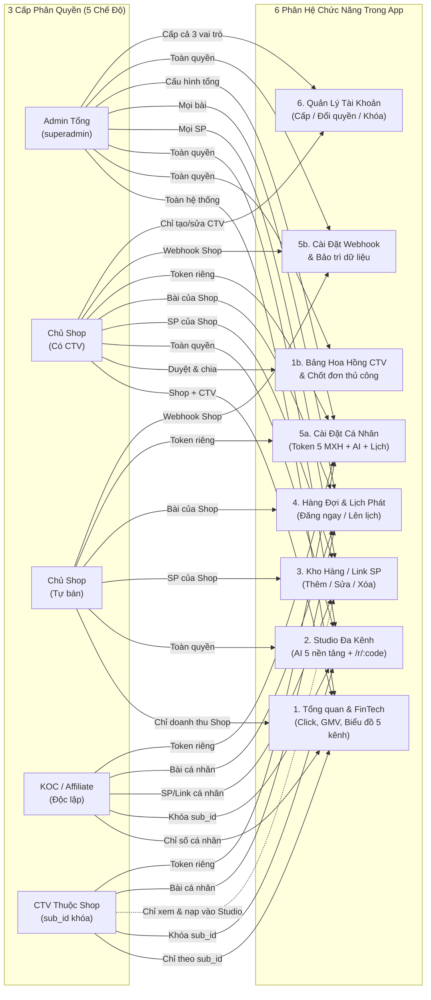
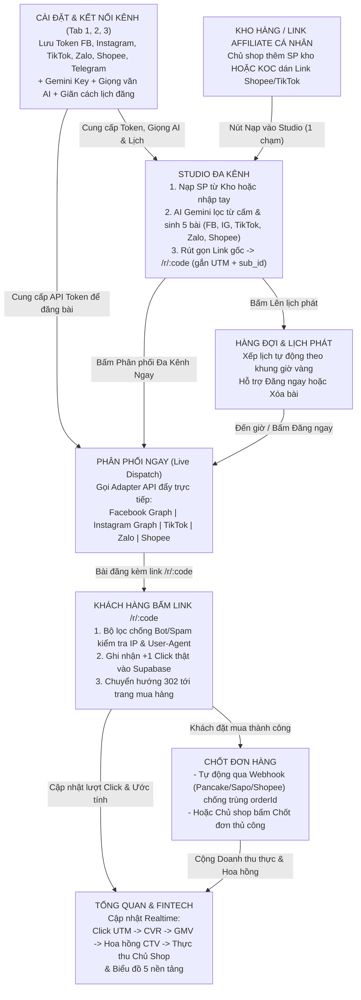
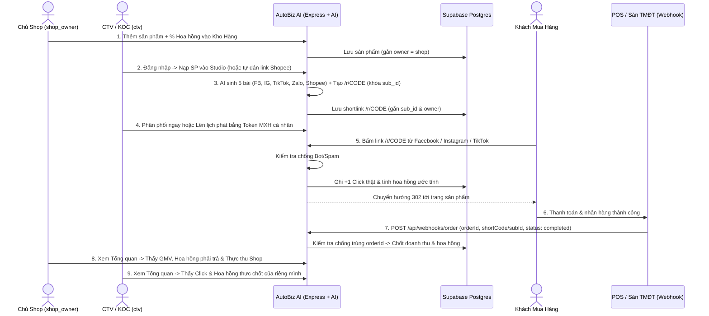

# Sơ Đồ Trực Quan: Phân Quyền 3 Cấp, Ma Trận Quyền Hạn & Luồng Liên Kết Chức Năng

Tài liệu này trực quan hóa toàn bộ cấu trúc phân quyền và cách 6 phân hệ trong **AutoBiz AI** liên kết dữ liệu với nhau theo thời gian thực trên nền tảng **Supabase Postgres**.

---

## 1. Cây Phân Cấp 3 Quyền & Phạm Vi Cô Lập Dữ Liệu (RBAC & Multi-Tenant)

---

## 2. Ma Trận Liên Kết Quyền Hạn Với 6 Phân Hệ Chức Năng

> [!TIP]
> **Quy ước mũi tên trong sơ đồ:**
> - **Mũi tên liền (`-->`)**: Có quyền truy cập & thao tác (tạo/sửa/xóa trong phạm vi dữ liệu cho phép).
> - **Mũi tên đứt (`-.->`)**: Chỉ có quyền **xem & nạp dữ liệu sang Studio** (không được thêm/sửa/xóa).
> - **Không có mũi tên nối**: Phân hệ/bảng đó được **ẩn tự động trên giao diện** và **chặn HTTP 403 ở Backend**.

---

## 3. Luồng Liên Kết Dữ Liệu Giữa Các Chức Năng (End-to-End Flow)

Sơ đồ dưới đây cho thấy dữ liệu chảy xuyên suốt từ lúc cài đặt Token cho đến khi sinh bài AI, phát sóng đa kênh, đếm click và chốt hoa hồng:

---

## 4. Chuỗi Tương Tác Thực Tế Giữa Chủ Shop, CTV & Hệ Thống (Sequence)

